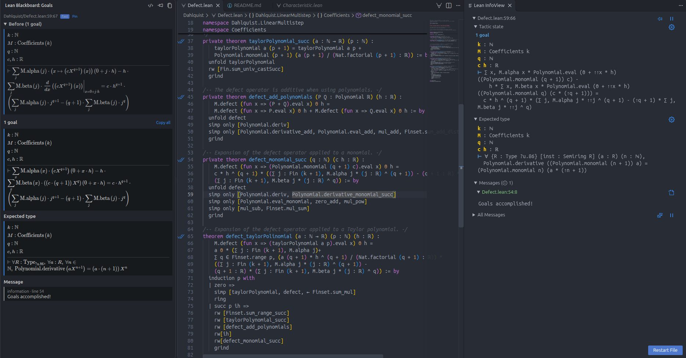

# Lean Blackboard

[English](README.md) · **Español**

Extensión de VS Code que muestra las hipótesis y objetivos de Lean 4 en la posición del cursor con
notación matemática renderizada (KaTeX), en un panel propio junto a la extensión oficial de Lean 4.
Reutiliza el servidor de Lean de la extensión oficial: sin procesos extra y sin configuración.



## Instalación

Requiere VS Code ≥ 1.90, la [extensión de Lean 4](https://marketplace.visualstudio.com/items?itemName=leanprover.lean4)
y Node.js para compilarla.

```sh
git clone https://github.com/amaseroaragon/lean-blackboard.git
cd lean-blackboard
npm install && npm run package
code --install-extension lean-blackboard.vsix
```

Abre un fichero `.lean` y pulsa el icono de pizarra de la barra de actividad.

## Modo preciso (opcional)

Por defecto los objetivos se convierten a partir del texto que imprime Lean. Para una conversión
que conoce los tipos (`⇒` frente a `→`, división entera, tipo al pasar el ratón, Ctrl/Cmd+clic a
la definición, los `def` como sus ecuaciones), añade el paquete Lean compañero al `lakefile.toml` de tu proyecto:

```toml
[[require]]
name = "LeanBlackboard"
git = "https://github.com/amaseroaragon/lean-blackboard"
rev = "main"
subDir = "lean"
```

Después ejecuta `lake update LeanBlackboard && lake build` y añade `import LeanBlackboard` en tus ficheros.

## Licencia

Este proyecto está distribuido bajo la licencia MIT. Consulta el archivo [LICENSE](LICENSE) para más información.
